<!--
  Pictures on this page update themselves:
  - the table at the top is drawn by scripts/listing/feature_graphic.py --readme (the store's
    feature graphic, without its black ground) into docs/images/readme-table.png;
  - the row under the badges is the store listing (metadata/en-US/images/phoneScreenshots/),
    re-shot on GitHub's emulator by .github/workflows/listing.yml;
  - the pictures in "More screenshots" are screenshot-test goldens (*/src/test/screenshots/), which
    CI checks on every push and goldens.yml re-records, so they always match the code.
  Renaming a screen test renames its golden: update the path here too.
-->

<p align="center">
  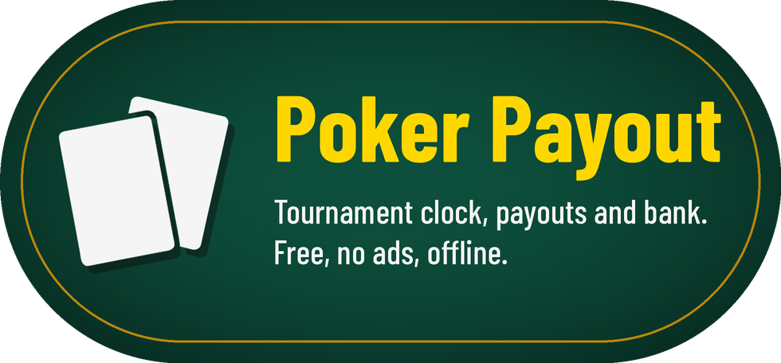
</p>

<p align="center"><b>A free Android app for home poker nights.</b></p>

<p align="center">
  A tournament clock with blinds that fit your chips, payouts that add up to the cent, a bank of
  who paid what, and tools for the table. Offline, no ads, no accounts.
</p>

<p align="center">
  <a href="https://github.com/HunterColes/PokerPayout/releases/latest"></a>
  <a href="https://github.com/HunterColes/PokerPayout/actions/workflows/ci.yml"></a>
  
  
  <a href="LICENSE.md"></a>
</p>

<p align="center">
  <a href="https://f-droid.org/packages/com.huntercoles.pokerpayout/"></a>
  &nbsp;
  <a href="https://github.com/HunterColes/PokerPayout/releases/latest"></a>
</p>

<p align="center">
  <a href="crypto/DONATIONS.md" title="Donate in Ethereum"></a>
  &nbsp;&nbsp;
  <a href="crypto/DONATIONS.md" title="Donate in Monero"></a>
  <br/>
  <sub>Like the app? You can say thanks with a donation.</sub>
</p>

<p align="center">
  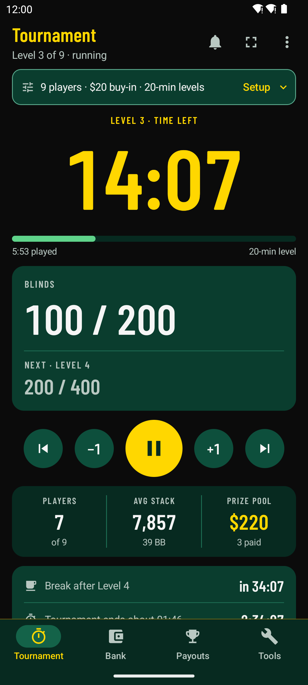
  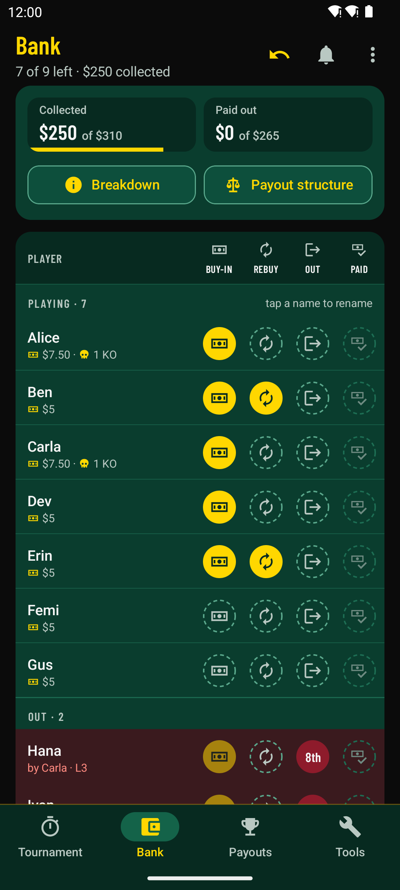
  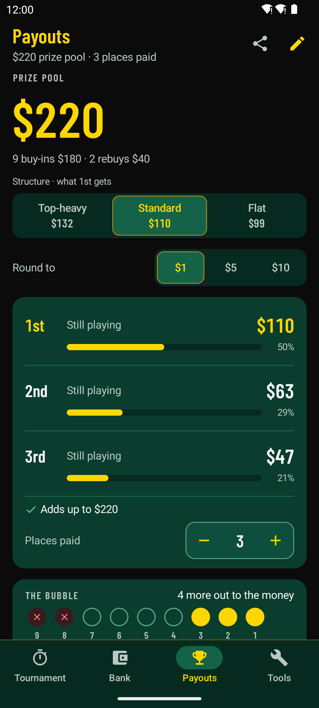
  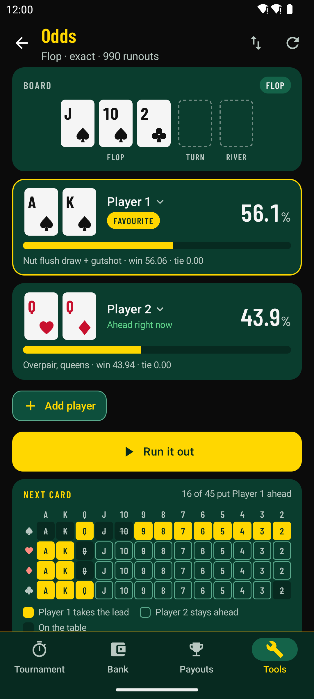
</p>

<p align="center">
  <a href="#whats-inside">What's inside</a> ·
  <a href="#private-by-design">Privacy</a> ·
  <a href="#install">Install</a> ·
  <a href="#support-the-app">Support the app</a> ·
  <a href="#contributing">Contributing</a>
</p>

## What's inside

### Tournament

- Set up the night once: players, buy-in, bounty, rebuys and late entry (each with a cutoff
  level), add-ons, food and a house rake if you take one. Save it as a preset and load it next
  time, or start from a ready-made night: Turbo, Classic, Deep stack or Bounty night.
- Blinds from four numbers: game length, level length, starting stack and smallest chip. Every
  level is a multiple of your smallest chip, and a setup that can't work says why and offers the
  nearest fix.
- A clock with big digits, the next level, ±1 minute nudges, breaks with a note and a big-blind
  ante. It keeps time through sleep, restarts and reboots.
- The running clock in the notifications and on the lock screen, with a chime, a vibration or a
  flash at each new level.
- Color-ups on breaks, overtime levels if the game runs long, and a full-screen table view when
  you turn the phone sideways, with Knock out right on it.
- The night's big moments on the clock: on the bubble, in the money, the final table and
  heads-up, then the champion's screen with what each place won.
- Share the setup as text for the group chat.

### Bank

- Who has paid the buy-in, rebuys and add-ons, and who has been paid out, with Undo.
- Pick tonight's players from everyone you've played with, the regulars first, or type a new
  name.
- Late arrivals and re-entries, each with its own buy-in and starting stack.
- Knockouts and bounties three ways: standard, progressive (half now, half onto the winner's own
  bounty) or mystery envelopes.
- Settle up at the end of the night: the fewest payments that square everyone, with a tick for
  each, when not everyone paid in at the start.
- Share the settle-up as text.

### Payouts

- Top-heavy, standard or flat, or your own weights, rounded to 1, 5 or 10 of your currency (100,
  500 or 1,000 yen).
- The places always add up to the prize pool, to the cent.
- A house rake, if you take one: a share of the prize pool for the host, shown wherever the pool
  is. Bounties and food are never raked.
- Share the payouts as text, and save the night to History once everyone is paid.

### Tools

In the order of the Tools tab, which follows a night:

- **Chip set:** stacks from the chips you own, and a color-up plan.
- **Seat draw:** random, balanced seats across your tables, and the high card for the button.
- **Odds** for two to ten hands (exact, or a close estimate when there are too many runouts),
  and run it out card by card.
- **Side pots:** when someone is all in, what each pot holds and who can win it.
- **Hand ranks:** what beats what, with how often each hand comes up.
- **Split the prizes:** a deal for the players left, by ICM or by chip chop, adding up to the
  prizes to the cent.
- **History:** saved nights, season points and the player of the year, and a CSV export for a
  spreadsheet.
- **Sound and music:** a chime before each level, break and the end; vibrate and flash for quiet
  rooms; and a playlist of songs from your phone that plays with the clock.
- **Currency:** $, €, £, ₹, ¥, kr and more, each written its own way, or no symbol at all.
- **Backup:** everything the app saves in one file, kept where you choose, and restored from it.

<details>
<summary><b>More screenshots</b> (a night from start to finish)</summary>
<br/>
<p align="center">
  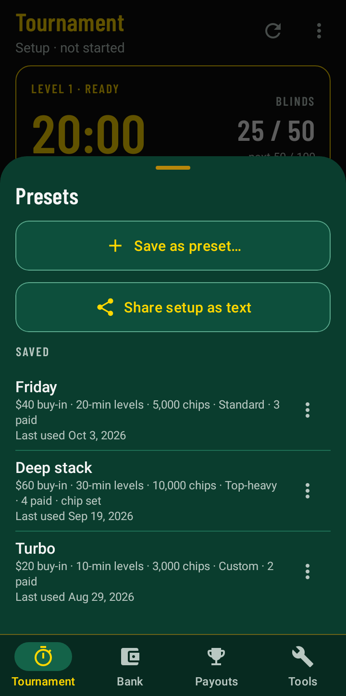
  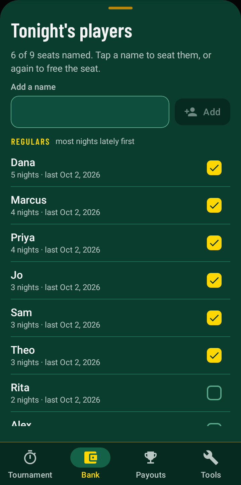
  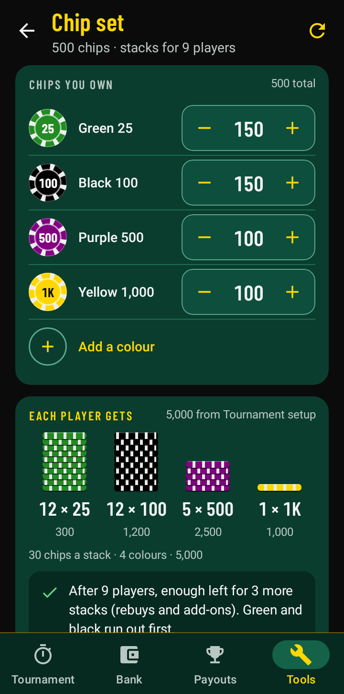
  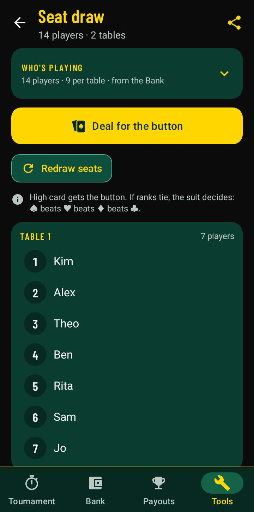
</p>
<p align="center">
  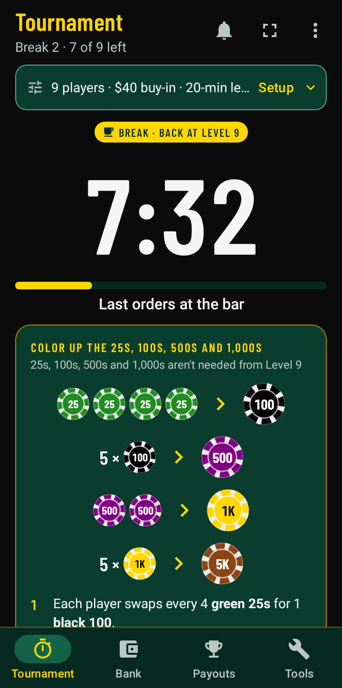
  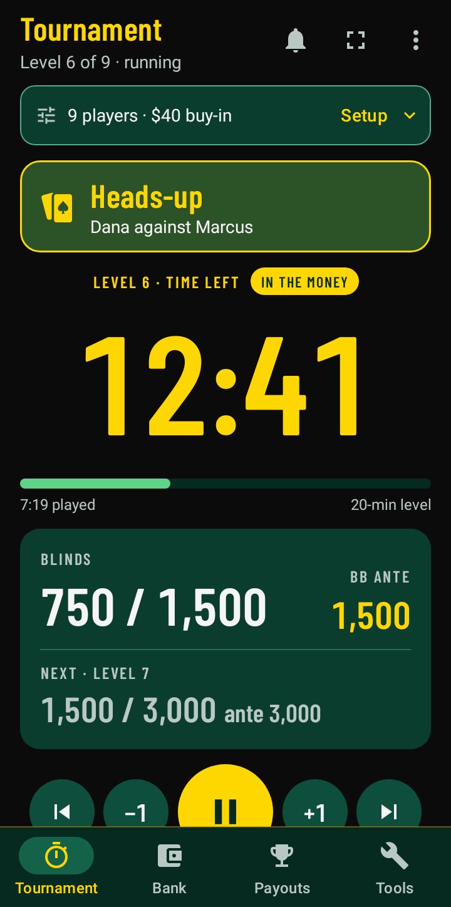
  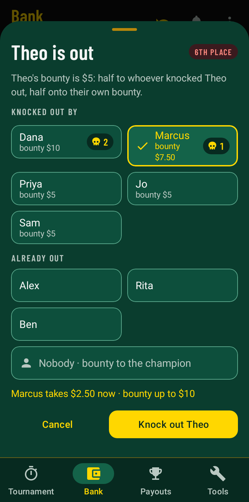
  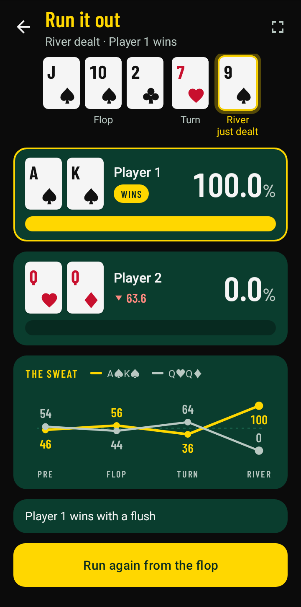
</p>
<p align="center">
  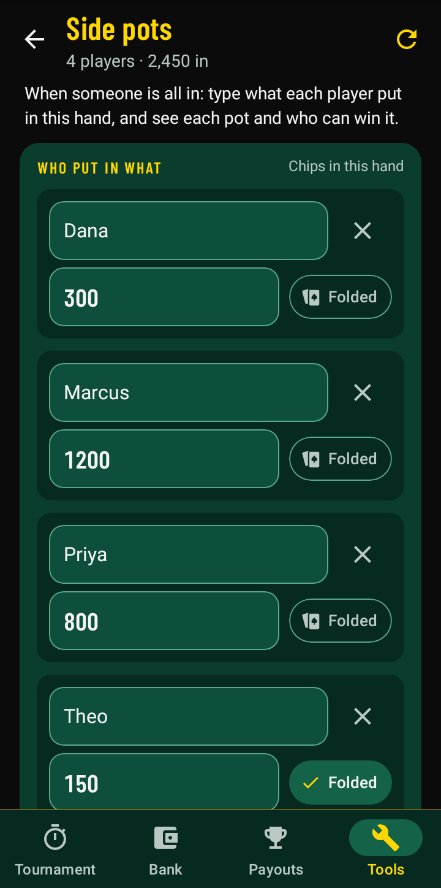
  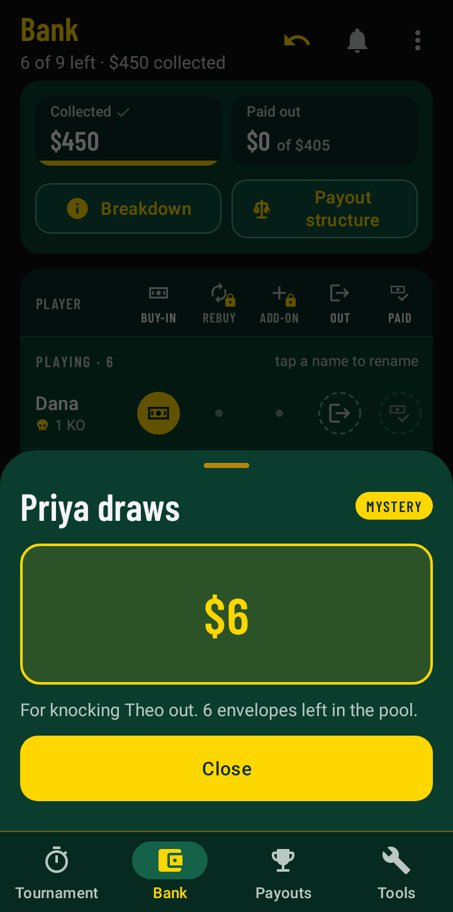
  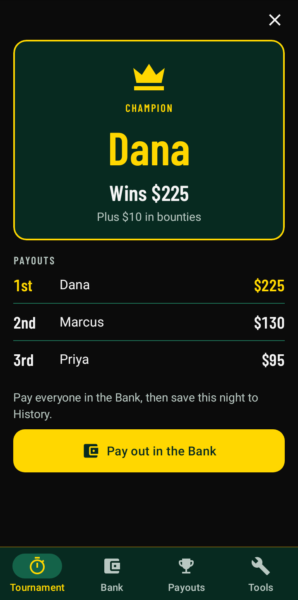
  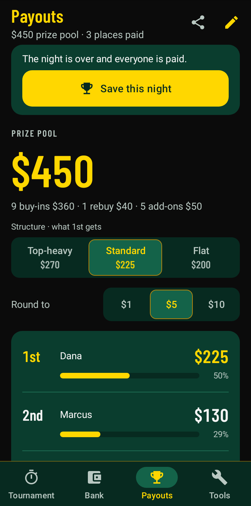
</p>
<p align="center">
  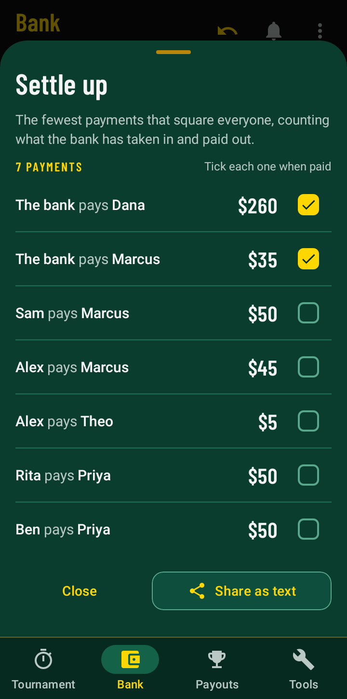
  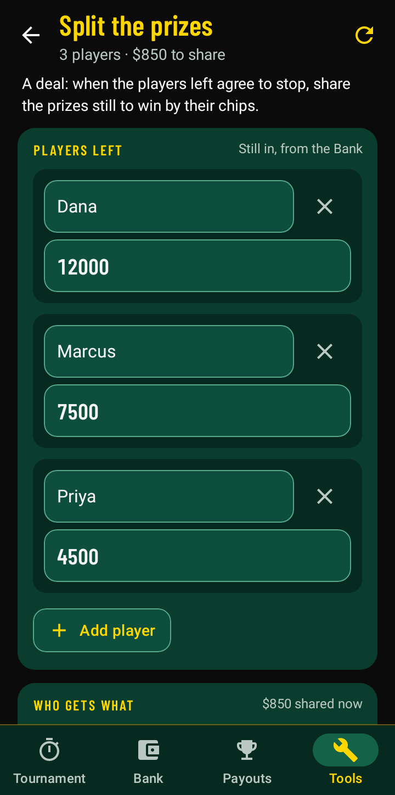
  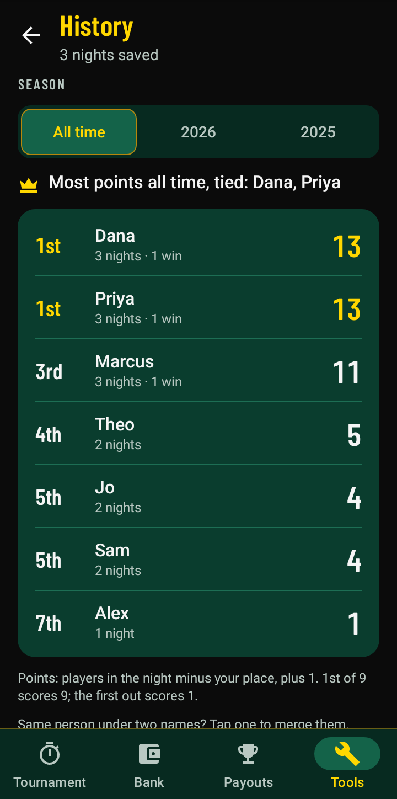
  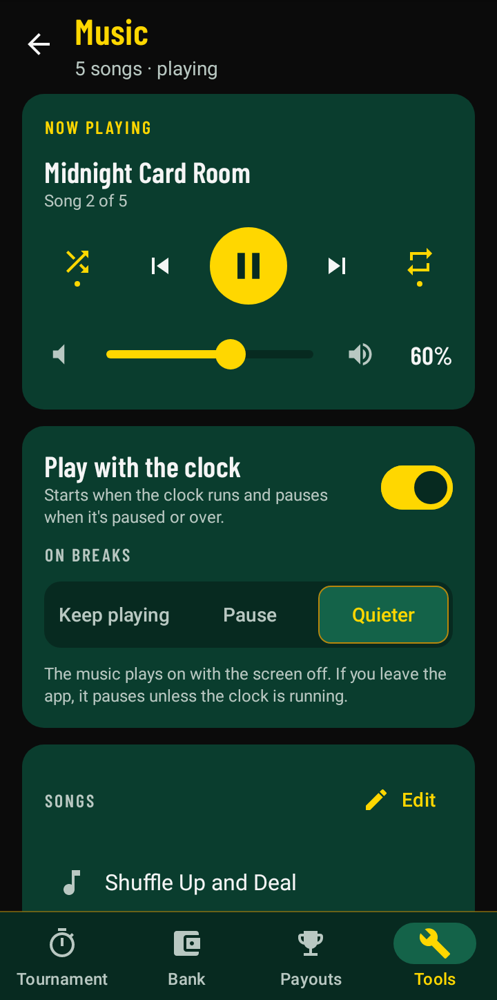
</p>
<p align="center">
  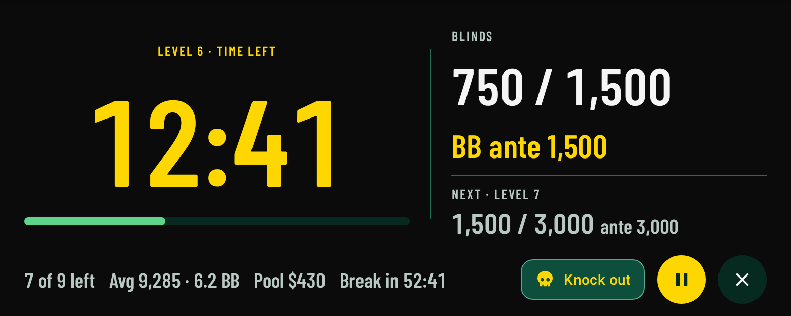
</p>

<sub>These pictures come from the app's screenshot tests. A change to a screen can't merge until
they're updated, so they always show the app as it is today.</sub>

</details>

## Private by design

- **No internet permission.** The app can't go online, so nothing you type can leave your phone
  through it.
- **No ads, no accounts, no analytics, no tracking.**
- **Your data stays on your phone,** in the app's own storage. Something leaves only when you tap
  Share, or save a backup or a CSV file where you choose.

The details are in [PRIVACY.md](PRIVACY.md).

## Install

- **[F-Droid](https://f-droid.org/packages/com.huntercoles.pokerpayout/)** (recommended): updates
  arrive by themselves. F-Droid builds each release from this source and checks it matches ours
  byte for byte, so it can be a few days behind GitHub.
- **[GitHub releases](https://github.com/HunterColes/PokerPayout/releases/latest):** download
  `PokerPayout-v….apk` on your phone and open it. Android may ask you to allow installs from your
  browser or files app.

Needs Android 8.0 or newer.

> **Coming from 1.1.x?** The signing key changed in 1.2.0, so Android can't update over it.
> Uninstall Poker Payout once, then install the new version. Uninstalling deletes saved data.
> Later updates install normally.

## Support the app

Poker Payout is free: no ads, nothing locked, nothing to sign up for. If it has run a few of your
poker nights and you'd like to say thanks, a donation is the nicest way. It pays for the time that
goes into new features and fixes.

**[Donate in Ethereum or Monero](crypto/DONATIONS.md)** (addresses and QR codes)

No crypto? These help just as much, and cost nothing:

- Star the repository, so more people find it.
- Tell your poker group, or the next home game you play in.
- [Report a bug or suggest an idea](https://github.com/HunterColes/PokerPayout/issues/new/choose).

Thank you. Every bit of support is noticed.

## Contributing

Help of any size is welcome, and most of it needs no code at all.

### Report a bug

Something not right? [Tell us what happened](https://github.com/HunterColes/PokerPayout/issues/new?template=bug.yml).
The form asks for the app version (it's at the bottom of the Tools tab), where you installed it
from, and your phone. A screenshot helps a lot. The app never sends anything by itself, so a report
is the only way we hear about a problem.

Before you open one, a quick look through the [open issues](https://github.com/HunterColes/PokerPayout/issues)
saves you the typing if someone has already reported it.

Found a security problem? Please report it privately, as [SECURITY.md](SECURITY.md) describes.

### Suggest an idea

[Tell us about the night it would help with](https://github.com/HunterColes/PokerPayout/issues/new?template=idea.yml),
and we'll work out the details together. The app stays free, offline and private, so ideas that
need the internet or an account won't fit. Everything else is worth a conversation.

### Translate

Poker Payout is in English for now. Translations will come later: if you'd like to see it in your
language, [open an idea](https://github.com/HunterColes/PokerPayout/issues/new?template=idea.yml)
and say which one, so we know where to start.

### Build it

You need JDK 21 and the Android SDK (API 34). The modules target Java 17 bytecode but build with a
JDK 21 toolchain, the same JDK F-Droid builds with.

```bash
git clone https://github.com/HunterColes/PokerPayout.git
cd PokerPayout
./gradlew assembleDebug    # the APK lands in app/build/outputs/apk/debug/
```

### Run the tests

```bash
./gradlew testDebugUnitTest lintDebug detekt
```

That's the same check CI runs. It includes the screenshot tests, which compare each screen with its
picture in `*/src/test/screenshots/`. If you change how a screen looks, record its pictures again
on purpose: [CONTRIBUTING.md](CONTRIBUTING.md#screenshot-tests) shows how.

### Where the checks run

Every pull request runs these on GitHub Actions, and you can follow them on its Checks tab:

- **Unit tests, lint, detekt** ([`ci.yml`](.github/workflows/ci.yml)), on every push too. A pull
  request merges only when this is green.
- **Device tour** ([`device.yml`](.github/workflows/device.yml)): the app on an Android emulator,
  debug and release builds, tapping through the main paths. It uploads screenshots and the log.
- **Monkey** ([`monkey.yml`](.github/workflows/monkey.yml)): thousands of random taps and swipes
  with fixed seeds, failing on a crash or a freeze.

Every run is listed under [Actions](https://github.com/HunterColes/PokerPayout/actions).

### Send a pull request

Pull requests are welcome. For anything bigger than a small fix, please open an issue first, so we
can agree on the approach before you spend the time. [CONTRIBUTING.md](CONTRIBUTING.md) has the
details: how the code is laid out, the few rules that keep it correct, and how the tests work.
[docs/TESTING.md](docs/TESTING.md) is the full guide to the tests, and
[docs/RELEASING.md](docs/RELEASING.md) covers releases, signing and F-Droid's reproducible builds.
Everyone taking part follows the [code of conduct](CODE_OF_CONDUCT.md).

**Built with** Kotlin, Jetpack Compose and Material 3. One module per tab (tournament, bank,
tools) on a shared core with the design system. Each screen is MVI: a ViewModel, its UI state and
intents, and a stateless composable. Hilt for dependency injection, Kotlin Coroutines and Flow,
settings and game state in SharedPreferences, and a version catalog for dependencies.

## Licence and credits

Made by **Hunter Coles** (owner and maintainer) with **Joshua Glenn** (co-author).

- [MIT License](LICENSE.md): free and open source.
- Font: [Barlow Condensed](https://github.com/jpt/barlow) by Jeremy Tribby, SIL Open Font License
  1.1 ([licence text](core/src/main/assets/licenses/OFL-BarlowCondensed.txt), shipped in the app).
- Icons: Material Symbols paths (Apache License 2.0), plus suits, chips and cards drawn for Poker
  Payout.

[Contributing](CONTRIBUTING.md) · [Code of conduct](CODE_OF_CONDUCT.md) ·
[Security](SECURITY.md) · [Privacy](PRIVACY.md) · [Changelog](CHANGELOG.md)
